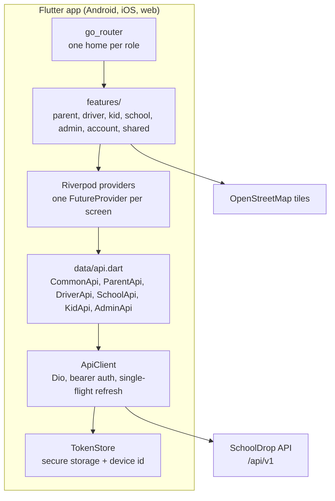

# SchoolDrop app — Architecture

One Flutter codebase serves every side of SchoolDrop: parents, drivers and kids on Android and iOS, and schools, parents and SchoolDrop staff on the web. This page covers how the app is built and why. The README covers running it. The backend is [schooldrop-be](https://github.com/GimbleBDub/schooldrop-be), with its own [architecture page](https://github.com/GimbleBDub/schooldrop-be/blob/main/docs/ARCHITECTURE.md).

## Overview

## Code layout

| Folder | Responsibility |
|---|---|
| `core/` | Config (`--dart-define`), API client, token store, device id, session, router, theme and design tokens, brand, shared widgets |
| `models/` | JSON models mirroring the backend DTOs |
| `data/api.dart` | One class per backend area; screens never build URLs themselves |
| `features/<role>/` | Screens and providers for each role |
| `features/account/` | Profile, password, signed-in devices, billing documents (shared by every role) |
| `features/shared/` | App shell (sidebar on wide screens, bottom navigation on phones), notifications, SOS, trip map, handover confirmation, school and location pickers |

## Key decisions

**One app for five audiences.** Signing in decides the home screen: go_router's redirect sends each role to its own area and blocks everything else. Before that, the same redirect forces a password change (staff given a temporary password) and onboarding (details each account type needs). The backend enforces the same rules, so the router is for experience, not security.

**Admin is web only.** The back office needs wide tables, a document viewer and a live trips map. A staff member signing in on a phone gets a screen pointing them to the web.

**Authentication without surprises.** `ApiClient` attaches the access token to every request. On a 401 it refreshes once, shared by all requests that failed at the same moment (a single in-flight future), then retries each request once through a separate Dio instance so the retry can't deadlock behind the queued interceptor. If the refresh fails, the session ends and the user returns to sign-in.

**Per-device sessions.** A random device id is created on first launch and sent with every sign-in. The backend keeps one refresh token per device, so signing in on the web doesn't sign out the phone, and users can see and revoke their signed-in devices by name.

**Simple state.** Riverpod 3 with a `FutureProvider` per screen, auto-disposed when the screen closes and invalidated after an action changes the data. No client-side cache to keep consistent; the server is the source of truth.

**Readable errors.** The backend's error shape (`{"success":false,"error":"…","data":{field: message}}`) becomes an `ApiException` with field errors shown next to the right inputs. Connection failures get their own message.

**Location sharing while driving.** On the trip screen the driver's position streams with a 30 m distance filter and is sent at most every 15 seconds, which keeps data and battery use low on cheap phones while the family's map stays current. Sharing stops when the screen closes; background tracking is tracked as an issue.

**Sandbox payments are a build flag.** `SANDBOX_PAYMENTS` (default on) shows "Simulate success/decline" so the whole booking flow can be tested before real payment providers exist. Production builds turn it off.

## Security and privacy

- Tokens and the device id live in the platform keystore (Keychain, Android Keystore). On the web, `flutter_secure_storage` encrypts them in browser storage; that is weaker than an HttpOnly cookie against cross-site scripting, a trade-off accepted for one auth flow across all platforms.
- Signing out revokes only this device's refresh token on the server; changing email or password signs out every other device (enforced by the backend).
- Password rules match the backend's, with a live checklist and the password asked twice.
- Driver documents are fetched as authenticated bytes, never as public URLs; invoice PDFs open through short-lived signed links from the backend.
- Kids pair with a one-time code from a parent instead of creating an account, and their accounts are read-only.
- Collecting a child the school hasn't released asks the driver to confirm and tells the family.

## Trade-offs

| Decision | Chosen | Alternative | Why |
|---|---|---|---|
| Codebase | One Flutter app for mobile and web | Separate web front end (e.g. React) for schools and admin | One developer, one language and one set of models and API calls. Cost: Flutter web loads slower and behaves less like a normal web page |
| Navigation | go_router only for top-level role homes; `Navigator` pushes inside a role | A URL for every screen | Simpler and enough for an app-first product. Cost: inner screens can't be deep-linked or bookmarked on the web |
| State | Per-screen `FutureProvider`s, invalidated after actions | Client-side store or cache | Always shows server truth; fewer bugs. Cost: more network calls, no offline mode |
| Token storage on web | Encrypted browser storage | HttpOnly cookies | Same auth flow on every platform. Cost: weaker against XSS on the web |
| Maps | OpenStreetMap via flutter_map | Google Maps | No API key or billing during development. The public tile server isn't for production traffic, so a tile provider is needed before launch (tracked as an issue) |

## Testing

`flutter analyze && flutter test`: widget and unit tests for models, billing, dialogs, password rules, the vehicle form, the driver verification wizard and the welcome screen.

## Open work

Tracked as GitHub issues in this repository.
